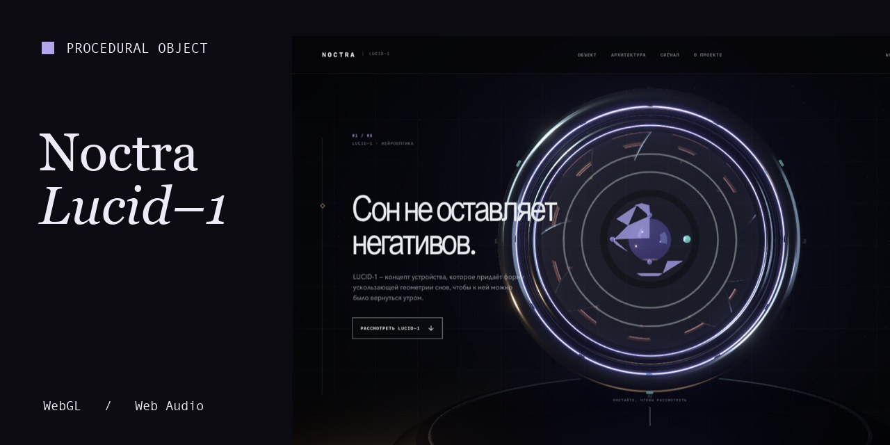
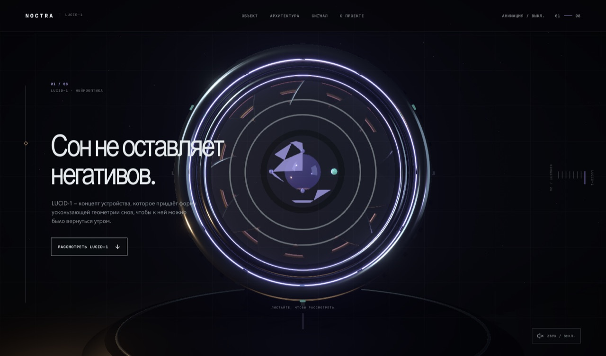
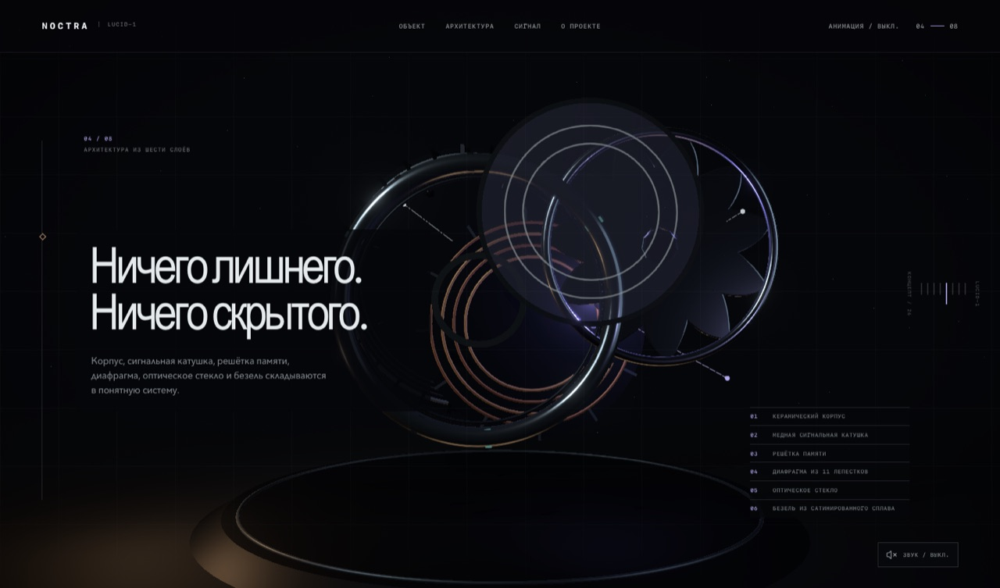
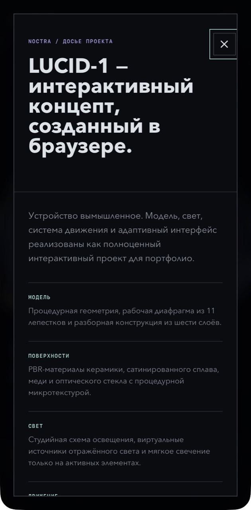

<a href="README.md"><picture><source media="(max-width: 600px)" srcset="https://raw.githubusercontent.com/mrjakeball/mrjakeball/main/assets/navigation/ru-on-compact.svg?v=2"></picture></a>
<a href="README_EN.md"><picture><source media="(max-width: 600px)" srcset="https://raw.githubusercontent.com/mrjakeball/mrjakeball/main/assets/navigation/en-off-compact.svg?v=2"></picture></a>
<a href="https://github.com/mrjakeball/portfolio"><picture><source media="(max-width: 600px)" srcset="https://raw.githubusercontent.com/mrjakeball/mrjakeball/main/assets/navigation/catalog-ru-compact.svg?v=2"></picture></a>

# NOCTRA / LUCID-1

Восемь сцен раскрывают устройство вымышленного объекта. Прокрутка ведёт от силуэта к послойному разбору конструкции и техническому досье.

Концепт, проверенный в WebKit · Публичная витрина приватного проекта  
React · Three.js · React Three Fiber · GSAP · Web Audio

## Как собрана сцена

Шесть слоёв модели формируются процедурно. Материалы PBR и направленный свет показывают внутреннюю структуру, а GSAP связывает движение с прокруткой. Web Audio добавляет звуковые акценты.

Для мобильного экрана предусмотрено отдельное досье. Есть облегчённая конфигурация, режим уменьшенного движения и запасной вариант отображения для устройств без WebGL.

## Три ракурса LUCID-1

**[Силуэт](assets/cover.jpg)** · Свет очерчивает внешний контур объекта. С этого ракурса начинается знакомство с моделью.

**[Конструкция](assets/screen-architecture-desktop.jpg)** · На разнесённом виде можно проследить, как слои располагаются относительно центральной оси.

**[Досье](assets/screen-dossier-mobile.jpg)** · На узком экране описание объекта можно читать последовательно в отдельной текстовой композиции.

Развернуть галерею

[Примечание о проекте](NOTICE.md) · [Профиль](https://github.com/mrjakeball) · [Каталог проектов](https://github.com/mrjakeball/portfolio)
