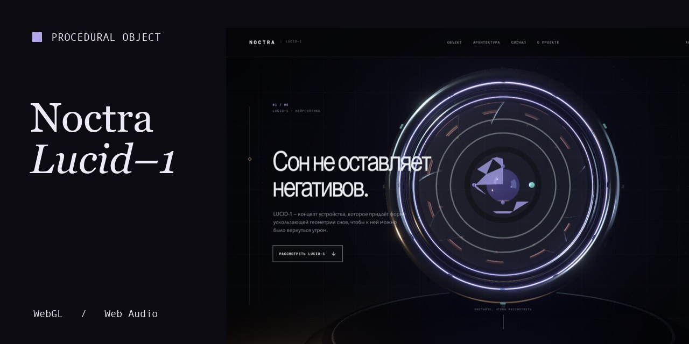
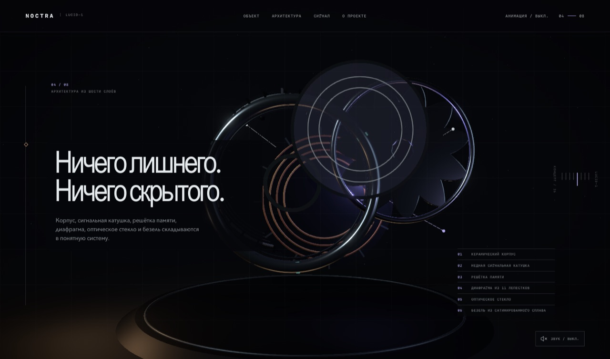
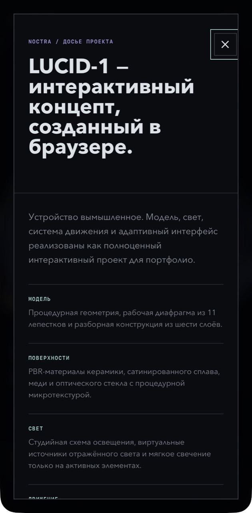

# NOCTRA / LUCID-1

Eight scenes explore a fictional device. Scrolling moves the viewer from its silhouette to an exploded view and a technical dossier.

Concept evaluated in WebKit · Public showcase of a private project  
React · Three.js · React Three Fiber · GSAP · Web Audio

## How the scene is built

Six procedural layers form the model. PBR materials and directed light reveal the internal structure, GSAP binds movement to scrolling, and Web Audio supplies sound cues.

A mobile dossier accompanies the scene. The project includes a lighter rendering configuration, reduced-motion support and a fallback for devices without WebGL.

## Original images

[Device silhouette](assets/cover.jpg) · [Exploded view](assets/screen-architecture-desktop.jpg) · [Mobile dossier](assets/screen-dossier-mobile.jpg)

View the gallery

[Project notice](NOTICE.md) · [Profile](https://github.com/mrjakeball/mrjakeball/blob/main/README_EN.md) · [Project catalogue](https://github.com/mrjakeball/portfolio/blob/main/README_EN.md)
